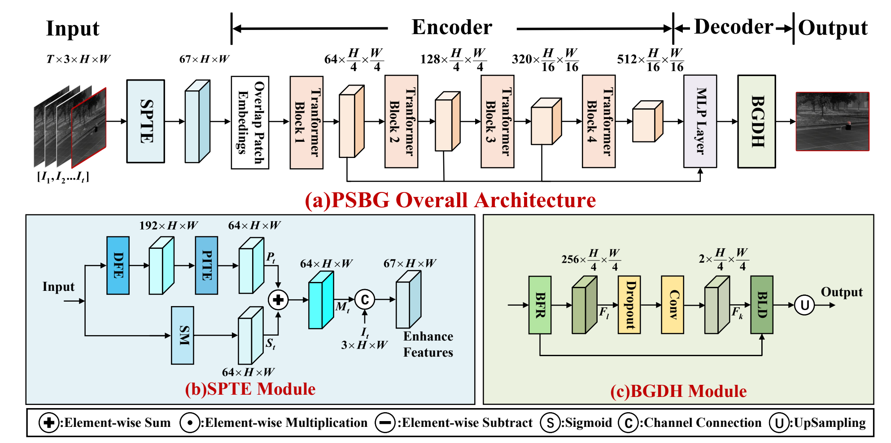
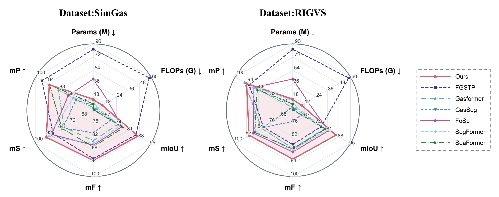
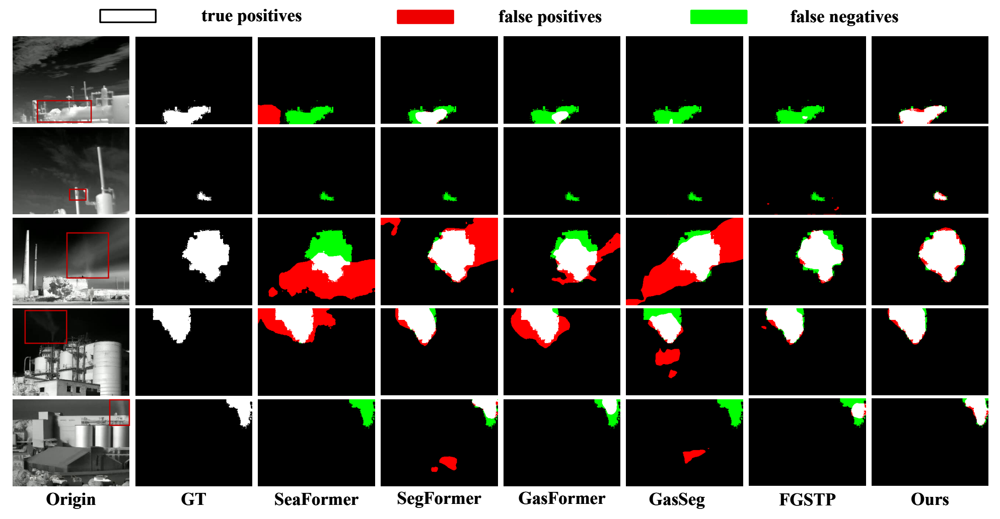
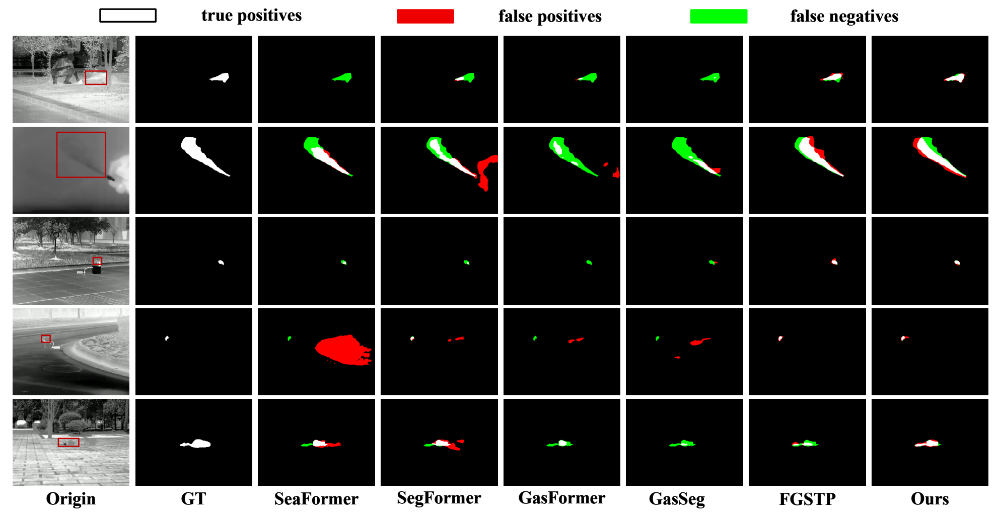

# PBG

**Physics-Inspired Temporal Enhancement and Boundary-Aware Decoding for Infrared Gas Video Segmentation**

This repository accompanies our work on **PSBG**, a framework for segmenting faint, semi-transparent gas plumes in infrared videos. PSBG combines Scene-aware Physics-inspired Temporal Enhancement (SPTE) with a Boundary-aware Gas Decoding Head (BGDH) to integrate temporal evolution, scene memory, and boundary guidance. We evaluate the framework on SimGas and our real-world infrared gas video dataset, RIGVS.

> **Code availability:** The code will be publicly released in this repository upon publication of the paper. Stay tuned for updates.

## Framework

SPTE combines physics-inspired temporal features with gated scene-memory cues, without requiring a pre-acquired gas-free background image. The MiT encoder extracts multi-scale features, and BGDH uses boundary guidance to refine features and segmentation logits.

## Experimental Results

### Performance and Model Complexity

Comparison of segmentation performance and model complexity on **SimGas** (left) and **RIGVS** (right). Arrows indicate the preferred direction for each metric.

### Qualitative Comparisons

**SimGas**

**RIGVS**

Each row shows one example. From left to right: input, ground truth (GT), SeaFormer, SegFormer, Gasformer, GasSeg, FGSTP, and PSBG (Ours). In the prediction error maps, **white**, **red**, and **green** indicate true positives, false positives, and false negatives, respectively. Red boxes in the input images mark gas regions of interest.
