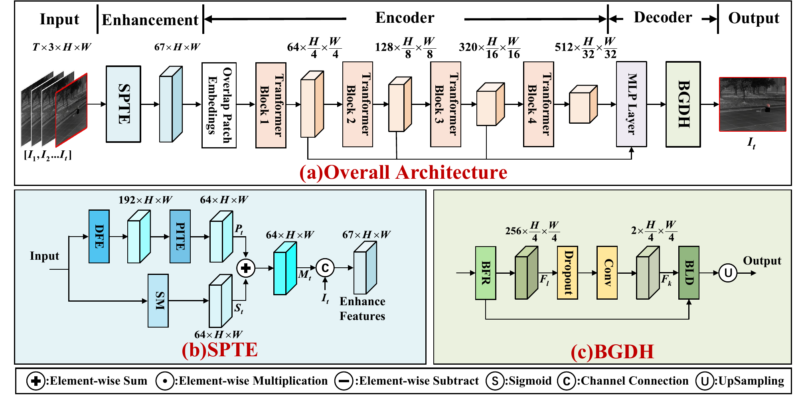

# PBG: Physics-Inspired and Boundary-Aware Infrared Gas Video Segmentation

**Tong Zuo, Yuan Liu, Junqi Bai, Xiaodong Kuang, Tong Jiang, Xiubao Sui, and Qian Chen**

PBG segments gas plumes in infrared videos by combining scene context, short-term temporal evolution, and boundary-aware decoding. It uses the current frame and two historical frames, without requiring a pre-acquired gas-free background image.

[Overview](#overview) | [Results](#manuscript-results) | [Installation](#installation) | [Data](#datasets-and-data-preparation) | [Training](#training) | [Evaluation](#evaluation) | [Citation](#citation)



*Architecture figure from the manuscript: (a) the overall pipeline, (b) Scene-aware Physics-Inspired Temporal Enhancement, and (c) the Boundary-aware Gas Decoding Head.*

## Overview

PBG combines two components around a MiT-B1 encoder:

- **Scene-aware Physics-Inspired Temporal Enhancement (SPTE)** combines Scene Memory (SM) with Physics-Inspired Temporal Evolution (PITE). SM builds a prototype from historical frames and gates scene-relative residual cues. PITE uses observed feature differences, learned transport/diffusion-inspired updates, spatial consistency weights, temporal attention, and deformable alignment. The resulting temporal feature is concatenated with the current image before encoding.
- **Boundary-aware Gas Decoding Head (BGDH)** fuses four encoder feature levels. Boundary-guided Feature Refinement (BFR) and Boundary-controlled Logit Diffusion (BLD) share a boundary gate to coordinate feature correction and local logit smoothing.

Training combines OHEM cross-entropy, weighted Dice loss, and auxiliary boundary supervision. The physical terms act in learned feature space; they are not calibrated estimates of gas concentration or fluid-flow parameters.

### Current implementation and manuscript

This repository contains the full-model training and evaluation code, with the two scalar coefficients removed from the current implementation:

| Operation | Manuscript | Current code |
|---|---|---|
| PITE consistency weight | Section 3.2.2, Eq. (2): sigmoid with scaling factor beta = 2 | `sigmoid(1 - residual_norm)`, with no scaling parameter |
| BLD logit update | Section 3.3.2, Eq. (8): update step lambda = 0.15 | `logits + conductance * (avg_pool(logits) - logits)`, with no step parameter |

Both current operations are equivalent to using unit coefficients in the original equations. Two BLD iterations are retained.

The model's state-dictionary keys and tensor shapes remain compatible with existing checkpoints, but its numerical predictions can change. Old configuration snapshots containing `conf_scale` or `diffusion_rate` must have those fields removed, or be replaced with the current [full-model configuration](configs/psbg_full.py). Retraining and evaluation are required to establish performance for this variant.

## Manuscript results

The following values are reported in Tables 1 and 2 of the manuscript. **They have not been re-evaluated for the current implementation without the two scalar coefficients.** All metrics are percentages.

| Dataset | mIoU | mF | mS | mP |
|---|---:|---:|---:|---:|
| SimGas | 87.19 | 92.77 | 92.64 | 92.94 |
| RIGVS | 86.28 | 92.10 | 90.34 | 94.02 |

The manuscript reports 14.82M parameters and 67.13 GFLOPs for PBG. These are manuscript reference values; this source release does not include the benchmark scripts, trained checkpoints, or dataset files used to produce the tables.

## Installation

The code uses the MMCV 1.x runner and parallel APIs, with a bundled subset of MMSegmentation. Do not install a separate MMSegmentation package over the local `mmseg` module.

| Component | Local verification environment |
|---|---|
| Python | 3.8.20 |
| PyTorch | 2.0.0 |
| CUDA runtime | 11.8 |
| MMCV-full | 1.7.2 |
| timm | 0.9.5 |
| MMEngine | 0.10.7 |
| Built-in `mmseg` version identifier | 0.11.0 |

The manuscript describes training on an NVIDIA RTX A5000 with 24 GB VRAM. Training and evaluation use an NVIDIA GPU and require the MMCV deformable-convolution operator.

Run the following commands from the repository root in a dedicated environment:

```bash
conda create -n pbg python=3.8 -y
conda activate pbg
python -m pip install torch==2.0.0 torchvision==0.15.1 --index-url https://download.pytorch.org/whl/cu118
python -m pip install mmcv-full==1.7.2 --only-binary=mmcv-full -f https://download.openmmlab.com/mmcv/dist/cu118/torch2.0/index.html
python -m pip install -r requirements.txt
python -m pip install -e . --no-deps
```

The installation example follows the [official PyTorch version pairing](https://pytorch.org/get-started/previous-versions/) and the [OpenMMLab CUDA 11.8 / PyTorch 2.0 wheel index](https://download.openmmlab.com/mmcv/dist/cu118/torch2.0/index.html). Local checks used an existing environment with TorchVision 0.15.0; the example uses the official 0.15.1 pairing and has not been tested by reinstalling a fresh environment.

Check the imports and command-line interfaces:

```bash
python -c "import torch, mmcv; from mmcv.ops import DeformConv2d; print(torch.__version__, torch.cuda.is_available(), mmcv.__version__)"
python tools/train.py --help
python tools/test.py --help
```

Use MMCV-full with working CUDA operators. The inherited implementation has a convolutional fallback when deformable convolution cannot be imported, which changes the model structure.

## Datasets and data preparation

The manuscript evaluates PBG on the following video-disjoint splits:

| Dataset | Source | Total videos | Annotated frames | Training videos | Evaluation videos |
|---|---|---:|---:|---:|---:|
| SimGas | Synthetic infrared gas videos | 31 | 12,128 | 20 | 11 |
| RIGVS | Real infrared gas videos collected for the study | 165 | 8,145 | 129 | 36 |

RIGVS was recorded at 320 x 256 resolution and 25 fps with a cooled infrared camera and a 3.2-3.4 micrometer narrow-band filter. Dataset images, masks, and video-ID split lists are **not included** in this source release. Split sizes alone do not reconstruct the exact experimental partitions.

Organize each dataset using the layout expected by the video reader:

```text
data/
├── SimGas/
│   ├── train.txt
│   ├── val.txt
│   ├── test.txt
│   └── data/
│       ├── video_001/
│       │   ├── origin/
│       │   │   ├── image_1.jpg
│       │   │   └── image_2.jpg
│       │   └── mask/
│       │       ├── image_1.png
│       │       └── image_2.png
│       └── ...
└── RIGVS/
    └── ...                  # Same directory structure
```

- Each split file contains one video directory name per line, such as `video_001`. Use no empty lines and retain a final newline.
- Default images are `.jpg`; masks are same-stem `.png` files containing class indices: `0` for background, `1` for gas, and `255` for ignored pixels.
- Frames are ordered by the last number in each filename stem, so `image_2.jpg` precedes `image_10.jpg`. Missing numeric IDs or duplicate IDs within one video raise an error. Keep only image files in `origin/`.
- The default three-frame window uses ordered image positions `[t-10, t-5, t]`. The stride counts available images, not differences between filename numbers.
- When history is insufficient, the model uses the current image and bypasses temporal enhancement for that sample. No future frames are used.
- Training samples one target window per video; validation and testing visit every target frame. The training loader drops incomplete batches, so fewer than four training videos require reducing `data.samples_per_gpu`.

Use the dataset's actual protocol to prepare the split lists. `val.txt` is used by the training validation hook. `--split test` explicitly selects `test.txt` for evaluation.

### Pretrained backbone

Obtain ImageNet-pretrained MiT-B1 weights from the [SegFormer project](https://github.com/NVlabs/SegFormer#training) and place them at:

```text
pretrained/mit_b1.pth
```

A different location can be selected with `--options model.pretrained=/path/to/mit_b1.pth`. Setting `model.pretrained=None` is suitable for a code smoke test, but does not reproduce pretrained initialization.

Full-model evaluation requires a trained PBG checkpoint; MiT-B1 backbone weights alone are insufficient. Neither pretrained nor trained weights are bundled with this repository.

## Training

All commands below run from the repository root. Paths supplied to `--data-root`, `--work-dir`, or checkpoint arguments can be absolute or relative to the working directory.

```bash
# SimGas
python tools/train.py --config configs/psbg_full.py --data-root ./data/SimGas --work-dir ./work_dirs/simgas --seed 207

# RIGVS
python tools/train.py --config configs/psbg_full.py --data-root ./data/RIGVS --work-dir ./work_dirs/rigvs --seed 207
```

`--data-root` updates all three dataset entries. The configuration's legacy default is `./data/gasvid`; the commands above override it explicitly.

The current [configuration](configs/psbg_full.py) uses:

| Setting | Value |
|---|---|
| Encoder | MiT-B1 |
| Clip length / temporal stride | 3 frames / 5 ordered image positions |
| Training crop tuple `(H, W)` | `(320, 256)` |
| Batch size | 4 clips per GPU |
| Optimizer | AdamW |
| Base learning rate / weight decay | `6e-5` / `0.05` |
| Schedule | 160,000 iterations; polynomial decay; 1,500 linear warmup iterations |
| Random seed | 207 |
| Checkpoint / validation interval | 10,000 iterations |
| EMA decay | 0.999 |
| Loss | OHEM cross-entropy + weighted Dice + `0.1` x boundary loss |

The decoder uses 256-channel embeddings, two BLD iterations, Dice class weights `[1, 20]`, and a boundary positive-class weight of `4`.

The output directory receives the resolved `config.py`, logs, and checkpoints. The configuration is serialized with Python's standard library to preserve tuples and avoid the old MMCV formatter's YAPF dependency.

Resume a run created with the current implementation:

```bash
python tools/train.py --config configs/psbg_full.py --data-root ./data/RIGVS --work-dir ./work_dirs/rigvs --resume-from ./work_dirs/rigvs/iter_100000.pth --options model.pretrained=None
```

Model and optimizer states are restored. The inherited EMA hook does not serialize its shadow parameters separately; these are initialized again from the restored model.

## Evaluation

For a checkpoint trained with the current implementation, use its saved configuration and explicitly choose the test split:

```bash
python tools/test.py --config ./work_dirs/simgas/config.py --checkpoint ./work_dirs/simgas/iter_160000.pth --data-root ./data/SimGas --split test --metrics-out ./outputs/simgas/metrics.json --mask-dir ./outputs/simgas/masks
python tools/test.py --config ./work_dirs/rigvs/config.py --checkpoint ./work_dirs/rigvs/iter_160000.pth --data-root ./data/RIGVS --split test --metrics-out ./outputs/rigvs/metrics.json --mask-dir ./outputs/rigvs/masks
```

You can also pass `--config configs/psbg_full.py`. The testing entry point disables backbone-pretraining loading and loads only the full-model checkpoint supplied with `--checkpoint`. Without `--split test`, the supplied configuration evaluates `val.txt`.

### Metrics

The evaluator prints per-class IoU, recall, precision, and Dice, then returns their means across background and gas:

| Manuscript metric | Evaluator / JSON key | Meaning |
|---|---|---|
| mIoU | `mIoU` | Mean intersection over union |
| mF | `mDice` | Mean Dice, equivalent to per-class F1 for hard masks |
| mS | `mRecall` | Mean sensitivity / recall |
| mP | `mPrecision` | Mean precision |

JSON values use the percentage scale, rounded to two decimal places. They are class averages, not gas-only scores. The manuscript's Boundary IoU and Boundary F1@2px analyses require additional evaluation code that is not part of this full-model release.

### Exported predictions

- `--mask-dir`: indexed PNG masks under `<mask-dir>/result_submission/<video>/<frame>.png`.
- `--show-dir`: image/prediction overlays.
- `--diff-dir`: prediction/ground-truth difference maps.
- `--out`: optional prediction pickle; no pickle is saved by default.

For example, add `--show-dir ./outputs/rigvs/overlays --diff-dir ./outputs/rigvs/diffs` to the RIGVS evaluation command.

## Repository layout

```text
.
├── assets/pbg_framework.png          # Architecture figure from the manuscript
├── configs/psbg_full.py              # Standalone full-model configuration
├── mmseg/
│   ├── apis/                        # Training and evaluation loops
│   ├── core/                        # Metrics, hooks, and EMA
│   ├── datasets/                    # Video readers and clip transforms
│   ├── models/                      # Full backbone, decoder, and losses
│   ├── ops/                         # Required tensor operations
│   └── utils/                       # Logging and environment information
├── tools/train.py
├── tools/test.py
├── requirements/runtime.txt
├── requirements.txt
├── setup.py
├── LICENSE
└── .gitignore
```

The paper name is **PBG**. Legacy `psbg` package/configuration names and TDMGas class identifiers are retained in the code for compatibility. This source-only release excludes comparison models, ablation implementations, datasets, split files, weights, and experiment outputs.

The current implementation has passed numerical checks against unit-coefficient reference equations, strict checkpoint loading, and GPU forward/backward smoke tests. Full-data retraining and benchmarking of this variant have not been performed.

## Citation

If you use PBG in your research, please cite the manuscript:

```bibtex
@unpublished{zuo_pbg,
  title  = {PBG: Physics-Inspired and Boundary-Aware Infrared Gas Video Segmentation},
  author = {Zuo, Tong and Liu, Yuan and Bai, Junqi and Kuang, Xiaodong and Jiang, Tong and Sui, Xiubao and Chen, Qian},
  note   = {Manuscript}
}
```

## Acknowledgments and license

This implementation builds on [SegFormer](https://github.com/NVlabs/SegFormer) and [MMSegmentation](https://github.com/open-mmlab/mmsegmentation). The local `mmseg` version identifier is inherited from the original project and does not indicate a complete upstream distribution.

The inherited NVIDIA Source Code License for SegFormer is retained in [LICENSE](LICENSE). Refer to that file for the terms, and preserve the upstream copyright and attribution notices when redistributing the code.
